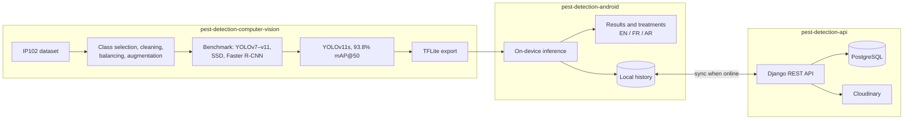

# Mobile pest detection system

This was my engineering thesis at ESI Algiers (2024–2025). The goal was a phone app that farmers can use in the field, without a network connection, to identify crop pests and get treatment advice.

The project is split into three repositories:

- [pest-detection-computer-vision](https://github.com/MehdiBedja/pest-detection-computer-vision): dataset preparation from IP102, training and benchmarking of the detection models, and export to TFLite.
- [pest-detection-android](https://github.com/MehdiBedja/pest-detection-android): the Android app (Kotlin, Jetpack Compose). It runs the model on the device and works offline.
- [pest-detection-api](https://github.com/MehdiBedja/pest-detection-api): the Django REST backend for accounts and syncing detection history across devices.

## Model

I started from IP102 and kept 13 pest classes relevant to Algerian crops. I annotated extra images and balanced the classes to about 800 images each. Then I trained and compared YOLOv7, v8s, v8m, v9s, v10s, v11s, SSD MobileNetV2 and Faster R-CNN ResNet50 on the same test set.

YOLOv8m scored slightly higher (94.0% mAP@50), but YOLOv11s reached 93.8% with about a third of the parameters and FLOPs, which matters on a phone. So that's the model in the app, exported to TensorFlow Lite. The full comparison is in [pest-detection-computer-vision](https://github.com/MehdiBedja/pest-detection-computer-vision#benchmark).

## App

- Takes a photo or opens an image, runs detection locally, and draws boxes with the species and confidence.
- Shows treatment recommendations for each detected pest.
- Keeps a local history, which syncs to the backend when the phone is online. Deletions and notes sync too.
- Supports English, French and Arabic.

## Stack

PyTorch, Ultralytics, TensorFlow Lite, OpenCV · Kotlin, Jetpack Compose, Room, Retrofit · Django REST Framework, PostgreSQL, Cloudinary, Render.

## Author

Mahdi Bedja · [mehdibedja.github.io](https://mehdibedja.github.io) · [LinkedIn](https://www.linkedin.com/in/mahdi-bedja-0b94031b3/)
