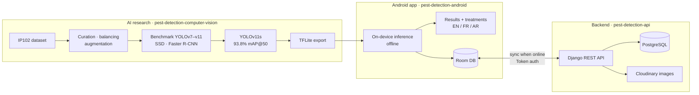

# Mobile Agricultural Pest Detection System

> An end-to-end, production-ready computer vision system designed for real-time agricultural pest identification in rural environments. Features applied AI research, dataset engineering, TFLite edge deployment, native mobile integration, and a dedicated backend API.

---

## System Architecture & Repositories

This project is modularized into three core components. Each repository manages a distinct part of the software pipeline:

* **AI & Computer Vision Research Repository:** [pest-detection-computer-vision](https://github.com/MehdiBedja/pest-detection-computer-vision)  
  Dataset engineering on IP102, multi-model benchmarking (YOLOv7–v11, SSD, Faster R-CNN), hyperparameter tuning, model quantization, and TFLite export.
* **Mobile App Frontend Repository:** [pest-detection-android](https://github.com/MehdiBedja/pest-detection-android)  
  Native Android app built with Kotlin and Jetpack Compose, featuring on-device TFLite inference, offline detection, multilingual interface, and recommended treatment workflows.
* **Backend API Repository:** [pest-detection-api](https://github.com/MehdiBedja/pest-detection-api)  
  RESTful backend developed with Django, PostgreSQL, and Cloudinary for user management, historical detection synchronization, and pesticide database management.

---

### How the pieces fit together

---

## Key System Features

* **Real-Time On-Device Inference:** Fully functional offline detection using a quantized YOLOv11s model running locally via TensorFlow Lite.
* **Comprehensive Pest Recognition:** Detects 13 critical agricultural pests with bounding boxes, confidence scores, and species names.
* **Treatment Mapping:** Automatically links identified pests with appropriate pesticides and application guidelines.
* **Cloud & Offline Sync:** Enables instant offline predictions on field with asynchronous background syncing when network connectivity is restored.

---

## AI Research & Model Benchmarking

The AI component addresses domain adaptation challenges on the IP102 benchmark dataset through custom preprocessing, balancing, and advanced data augmentation pipelines.

### Evaluated Architectures
Multiple object detection frameworks were benchmarked on a held-out test set:

| Architecture | Model Variant | Target Use Case | Status |
| :--- | :--- | :--- | :--- |
| **YOLOv11** | **v11s (Final)** | **Edge Deployment (Mobile)** | **Selected (93.8% mAP@50)** |
| **YOLO Series** | v7, v8 (s/m), v9, v10 | Accuracy vs. Latency Trade-off | Benchmarked |
| **SSD** | MobileNet v2 | Lightweight Baseline | Benchmarked |
| **Faster R-CNN** | ResNet50 | High-Accuracy Baseline | Benchmarked |

### Performance Highlights
* **Final Model:** YOLOv11s (Optimized accuracy-latency trade-off for mobile processors).
* **Metrics:** Achieved 93.8% mAP@50.
* **Edge Optimization:** Converted and quantized to TensorFlow Lite (TFLite) for fast, zero-latency local execution on Android devices.

---

## Tech Stack Summary

* **AI & Data:** PyTorch, Ultralytics, TensorFlow Lite, OpenCV, IP102 Dataset, Data Augmentation.
* **Mobile Client:** Kotlin, Jetpack Compose, TFLite Android SDK, Google Sign-In, Multilingual i18n.
* **Backend & DevOps:** Python, Django, REST Framework, PostgreSQL, Cloudinary, Docker, Render.

---

## Author
**Mahdi Bedja** — AI Engineer  
* Paris, France  
* GitHub: [@MehdiBedja](https://github.com/MehdiBedja)  
* LinkedIn: [linkedin.com/in/mahdi-bedja-0b94031b3](https://www.linkedin.com/in/mahdi-bedja-0b94031b3/)  
* Portfolio: [mehdibedja.github.io](https://mehdibedja.github.io)
